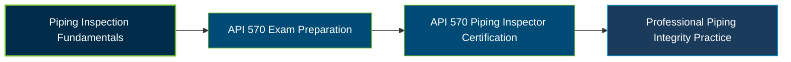

# API 570 Piping Inspector Certification Exam Guide

A dedicated study guide and technical reference repository for candidates preparing for the **American Petroleum Institute (API) 570 Piping Inspector Certification Exam**, focused on in-service metallic piping inspection, integrity, repair, and alteration.

---

## Exam Overview

The API 570 Piping Inspector certification validates the knowledge required to inspect, evaluate, maintain, repair, alter, and rerate in-service metallic piping systems in the petroleum and petrochemical industries.

- **Exam Format**: Computer-based, proctored examination with closed-book and open-book sections; primarily multiple-choice questions. The exam is administered in person at designated test centers.
- **Target Audience**: Piping inspectors, mechanical integrity professionals, inspection engineers, and personnel involved in piping maintenance, repair, and inspection.
- **Prerequisites**: A combination of education and relevant piping-system work experience is required. Eligibility ranges from one year of experience for qualifying engineering graduates to five or more years for applicants without formal education, with specified inspection experience requirements.

---

## Core Exam Domains & Knowledge Areas

### 1. Calculations for Evaluating Thickness Measurements, Inspection Intervals, and Piping Integrity

- Corrosion rates, remaining life, and inspection interval calculations.
- Minimum required pipe thickness, internal pressure, and maximum allowable working pressure.
- Pressure testing, thermal expansion, impact testing, and flange ratings.

### 2. Welding Procedure and Qualification Evaluation

- Review of Welding Procedure Specifications (WPS), Procedure Qualification Records (PQR), and Welder Performance Qualifications (WPQ).
- Essential variables, mechanical testing, and welding procedure compliance.
- Welding requirements under API 570, ASME Section IX, ASME B31.3, and API RP 577.

### 3. Nondestructive Examination

- Radiographic, liquid penetrant, magnetic particle, and visual examination methods.
- Leak testing and ultrasonic thickness measurement requirements.
- NDE procedures, calibration, evaluation, and inspection documentation.

### 4. Practical Knowledge – General

- Piping inspection methods, maintenance inspection safety, and inspection records.
- Corrosion evaluation, minimum thickness, remaining life, and inspection intervals.
- Piping repairs, alterations, rerating, pressure testing, and material verification.

### 5. Practical Knowledge – Specific

- API 570, API RP 571, API RP 574, API RP 576, API RP 577, and API RP 578 requirements.
- ASME B31.3, B16.5, Section V, and Section IX reference requirements.
- ASME PCC-2 repair methods, pressure equipment integrity, and piping inspection practices.

---

## Certification Path

The following diagram represents a suggested preparation and professional development progression.

---

## Recommended Practice & Study Resources

Prepare for the API 570 examination using the official Body of Knowledge, applicable code editions, and practical piping inspection knowledge.

- **CertsGate**: Explore [API 570 Piping Inspector exam preparation resources](https://certsgate.com/exams/api/api-570) for supplementary study materials and practice to review piping inspection concepts and identify knowledge gaps.
- **API and ASME Standards**: Study the applicable [API publications](https://www.api.org/products-and-services/individual-certification-programs/certifications/api570) and ASME standards, including API 570, API RP 571, API RP 574, ASME B31.3, and ASME Section V, using the editions specified for your exam window.
